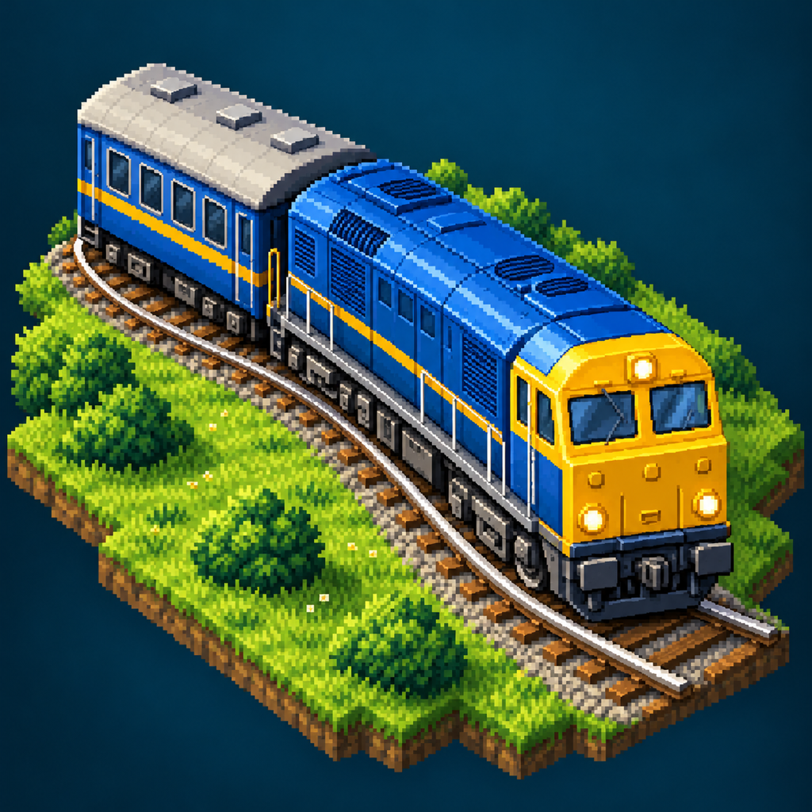
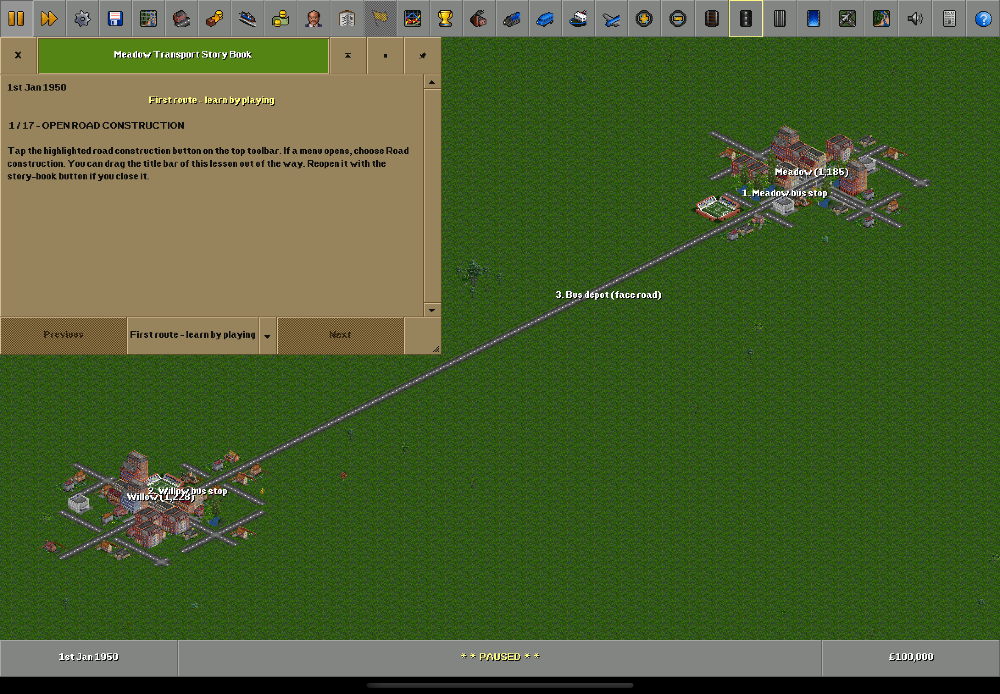

<p align="center"></p>

# OpenTTD Reimagined

### The game you know. Room for your fingers.

An independent, experimental native iPad and iPhone adaptation of **OpenTTD 15.3**. Keep the original simulation, pixel art, toolbars, windows and wonderfully deep transport networks. Make them usable on a touchscreen.

**[Explore the project](https://rubarksfield.github.io/openttd-reimagined/) · [Build it yourself](#build-and-play) · [Contribute](CONTRIBUTING.md) · [Original OpenTTD](https://www.openttd.org/)**



## What this is

The actual C++ game runs inside a UIKit application. Its original CPU renderer is presented through Metal. Touch gestures drive the existing camera, construction tools and validated commands. Gameplay rules live in OpenTTD, not in a replacement simulation.

- Original interface, terminology, sprites and simulation.
- One-finger panning, stepped pinch zoom and two-finger panning while building.
- Native document import for saves and compatible community packages.
- Classic free OpenGFX graphics and OpenSFX sound effects.
- An original-style reading guide and a playable first-bus-route lesson built with the original GameScript, Story Book and widget-highlighting APIs.
- Shared C++ importer with bounded extraction, path and link checks, and recovery handling.

This is **a development prototype**. It is not an official OpenTTD release, and the OpenTTD project does not endorse it. Android and a redesigned Mac client remain future work. Continuous zoom, inertia, music, PNG/LZO support, multiplayer acceptance and broad real-device performance testing remain open.

## What has evidence

Real native simulator play-throughs have built earning bus routes and a working railway route, purchased vehicles, configured orders, carried passengers and earned fares. Native saves have round-tripped through an unchanged OpenTTD 15.3 reference build. Compatible NewGRF content has been downloaded and imported through the original infrastructure and native Files picker.

A development-signed build has also been installed and launched on a physical iPad. This does not establish full hardware gameplay or performance acceptance. The reference test baseline has 94 passing original unit cases and two original regression comparisons; import/resource checks add 44 sanitizer checks.

The guided level also passed a fresh, complete 0–17 iPad simulator play-through using actual touch/HID, including passenger pickup and fare income.

See [current tutorial and release status](docs/TESTING.md). TestFlight and App Store availability will be linked here only after it actually exists.

## Build and play

Requires an Apple Silicon Mac, full Xcode with an iOS SDK, Python 3.12+, and the normal Xcode command-line tools. Python 3.13 was used for the current local build. Select a Python with tarfile's safe extraction support. The build downloads pinned upstream source and free resources; no original Transport Tycoon assets are required.

```sh
./script/bootstrap_tools.sh
./script/build_reference.sh
./script/build_ipad_app.sh xcode
open build/ipad-xcode/OpenTTDPad.xcodeproj
```

Select **OpenTTDPad**, choose your simulator or your own development team/device, then Run. The generated project is disposable; edit `native/`, `cmake/`, `content/` and `patches/`.

For command-line simulator builds and reference checks:

```sh
./script/build_ipad_app.sh simulator
python3 script/test_reference.py
python3 script/test_content_import.py
python3 script/test_managed_resources.py
python3 script/prepare_tutorial.py
```

The last command verifies the lesson save in stock OpenTTD. GUI/HID checks require a separately configured, project-owned simulator fixture. They do not run against your personal game automatically.

## Fork it. Break it. Build something better.

Please experiment. Fork the repository, try an input idea, add a lesson, improve an original window, or help test a feature we have not exercised. Small changes with a reproducible in-game result are especially welcome.

Useful places to start:

| Area | Code |
|---|---|
| Native host, input, Metal presentation | `native/apple/App.mm` |
| Original engine adapter | `native/apple/EngineBridge.cpp` |
| Original-style first-steps window | `native/shared/TutorialGuide.cpp` |
| Playable tutorial and translations | `content/game/TouchFirstRoute/` |
| Content import boundaries | `native/shared/ContentImporter.cpp` |
| Reviewed original UI changes | `patches/` |
| Pinned engine/dependency preparation | `script/` and `cmake/` |

Keep simulation changes out of the platform UI. Preserve upstream notices. Be candid about what you tested. Read [CONTRIBUTING](CONTRIBUTING.md) and [the architecture](docs/ARCHITECTURE.md).

## Credits and licence

This work depends on the extraordinary work of the OpenTTD contributors and the OpenGFX/OpenSFX communities. OpenTTD is based on Transport Tycoon Deluxe by Chris Sawyer. Original marks remain with their owners.

Our linked application code, UI patches and tutorial are distributed under **GPL-2.0**, preserving upstream and dependency notices. See [COPYING](COPYING.md) and [THIRD_PARTY](THIRD_PARTY.md). The app icon is AI-generated artwork released with this project; implementation and testing also used substantial Codex assistance. AI-generated concepts are not gameplay evidence.

Publishing source does not by itself settle Apple store terms, downloaded-script review or asset obligations for a future binary release. Store distribution remains a separate gate. Never bundle proprietary TTD resources or redistribute someone else's NewGRF without its permission and required source/notices.
