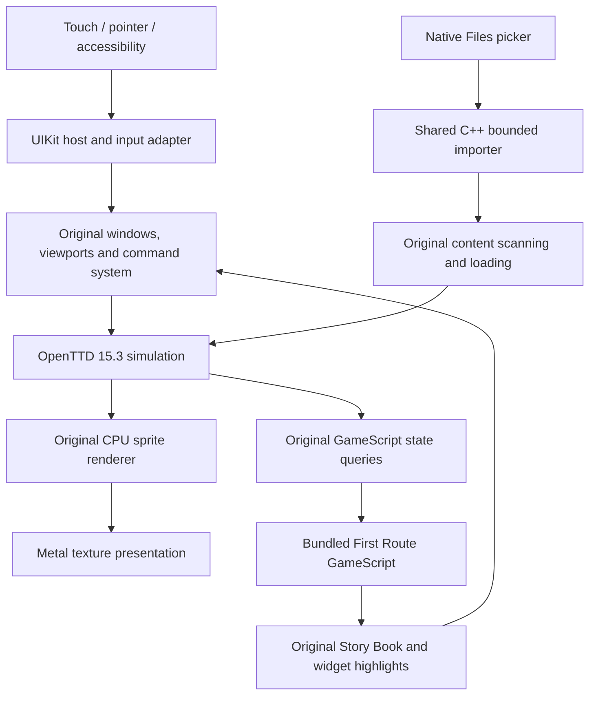

# Keep the engine. Adapt the boundary.

The pinned OpenTTD 15.3 C++ engine supplies the world, economy, vehicles, signals, validated commands, networking, NewGRF/script interpreters and save/load. The independent reference build is unmodified. The mobile tree differs only by an explicit, byte-verified UI/header patch series.

`App.mm` owns Apple lifecycle, touch gestures, keyboard/accessibility integration and Metal presentation. `EngineBridge.cpp` serializes incoming actions onto the engine thread; it does not implement construction rules. `ContentImporter.cpp` stages bounded imports before notifying original scanners. Simulation timers remain original; drawing is scheduled separately. A 60 Hz render configuration is not a measured hardware performance claim.

The tutorial validates an authored 128-square world, labels its tasks, uses original Story Book/highlight APIs, and observes actual stations, depot orientation, purchased buses, orders, movement, passengers and income. It does not build the player's route. Construction is paced with original GameScript pause and command-pause settings, scoped to the lesson save. Its state is serialized by original save/load.

No claim is made that OpenTTD is already a clean headless reusable library. Existing UI/global state remains coupled. The host links the full engine; the small patch series is the current practical boundary. A future Android host can reuse C++ and content logic, but Kotlin/Vulkan integration is not implemented here. Upstream updates require renewed source verification, patch review and compatibility tests.
